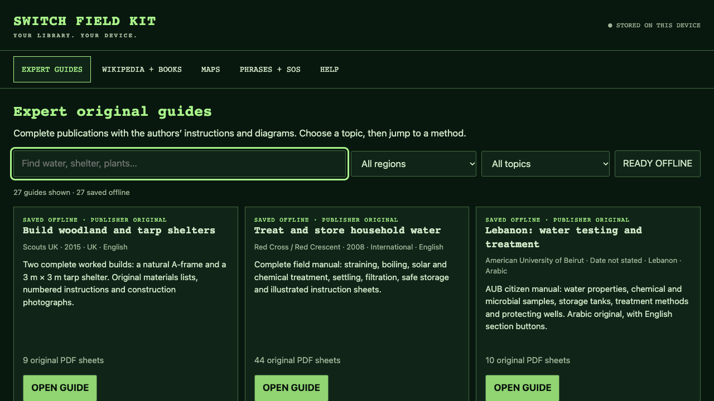

# Switch Field Kit

**Turn a compatible Nintendo Switch into a useful offline reference library.**

Original illustrated guides, searchable Wikipedia books and optional offline maps, in a clear green interface built for a small touchscreen. Download what you need once. Read it without an account or internet connection.

[Download a tested release](https://github.com/majd-caseresolvetech/switch-field-kit/releases/latest) · [Start here](docs/START_HERE.md) · [Install Hekate + Ubuntu first](docs/INSTALL_HEKATE_UBUNTU.md) · [Guide catalogue](docs/CONTENT.md) · [Maps](docs/MAPS.md) · [Troubleshooting](docs/TROUBLESHOOTING.md)



## What you get

- **27 publisher originals, 466 PDF sheets.** UK, Lebanese and international references from Scouts, Ordnance Survey, AUB, IFRC, WHO/WEDC, HSE, Plantlife and the British Naturalists Association. Downloaded directly from their publishers, with their original text and diagrams.
- **Quick access inside long guides.** Section shortcuts, search, image enlargement and saved reading positions. One page loads at a time.
- **Wikipedia and other ZIM books.** Optional Kiwix integration with full-text search. Add books without making another copy.
- **Offline maps.** Optional world, UK, Lebanon, Prague and Europe-to-Levant overview downloads. The installer checks the estimated size before downloading.
- **Basic phrases and SOS reference.** English, Arabic and Czech phrases, plus a Morse reference. These project-written cards are separate from expert publications.
- **A small, understandable codebase.** Python standard library and plain HTML/CSS/JavaScript. No cloud account, analytics or background content downloads.

## Before you start

This is an **Ubuntu application**, not a tool that unlocks a stock console.

| What works on your Switch now? | Start here |
| --- | --- |
| Ubuntu desktop | Follow the three installation steps below. |
| Hekate, but no Ubuntu | [Back up and install Ubuntu first](docs/INSTALL_HEKATE_UBUNTU.md#3-back-up-before-changing-the-card). |
| Only the normal Nintendo menu | [Check compatibility first](docs/INSTALL_HEKATE_UBUNTU.md#1-check-which-switch-you-have). Some models require specialist hardware work. |

You need a Switch that already boots **Hekate and Switchroot Ubuntu**. If yours does not, follow our [beginner Hekate and Ubuntu installation guide](docs/INSTALL_HEKATE_UBUNTU.md) first. It covers compatibility, backups, Windows/Mac/Linux payload setup, SD space, Ubuntu installation and checking stock fallback, with links to the upstream instructions. Compatibility differs between original unpatched units, patched units, Lite and OLED. Switch 2 is not supported by this project.

The installer **does not format the SD card, change partitions, modify Hekate, install custom firmware or remove your stock boot option**. Keep a working stock fallback and your own backups. A 128 GB card is usable, but the free space in Ubuntu matters more than the number printed on the card.

## Install once Ubuntu is working

1. Open [the latest release](https://github.com/majd-caseresolvetech/switch-field-kit/releases/latest). Under **Assets**, download `switch-field-kit-<version>.zip` **on the Switch**, or copy it there from another computer. You do not need Node, npm or Git.
2. Extract it. Open the extracted folder, right-click an empty area and choose **Open in Terminal**.
3. Run:

```bash
bash setup.sh
```

The installer explains missing dependencies, creates Applications and desktop shortcuts, starts a local reader and offers to download the original guide pack. **Field Kit opens automatically after Ubuntu sign-in.** Allow **1 GB of free Ubuntu space** for the starter pack and rendering. Wikipedia and maps are separate choices.

Open **Switch Field Kit** from Ubuntu’s Applications menu, or open `http://127.0.0.1:8095` in its browser. **HELP** explains how to add content, with commands you can copy into Terminal. **MAPS** offers named areas and calculates the download size before you accept. Wikipedia and maps are not bundled with the app.

After installing content, choose **REFRESH LIBRARY**. Turn Wi-Fi off and check the guides, book searches and maps you expect to use. If a download fails, retry its command. Completed guides are kept and you do not need to reinstall the app.

For a smaller first download:

```bash
bash setup.sh --no-guides
~/.local/bin/fieldkit guides scouts-shelter,ifrc-water,hse-first-aid
```

See the [beginner walkthrough](docs/START_HERE.md) for stock-console preparation, storage, downloads and first-use checks.

### Make it a turn-on-and-read device

There are three separate settings: Hekate starts Ubuntu, Ubuntu signs in, and Field Kit opens. Setup handles the last one. Follow [automatic startup and the full reboot check](docs/START_HERE.md#7-open-straight-into-field-kit) for the other two and for returning to stock. Keep your existing boot entries rather than copying someone else's configuration.

Prefer opening the app yourself? Run `~/.local/bin/fieldkit autostart off`. Use `on` to restore automatic opening. Setup also accepts `--no-autostart`, and updates keep your choice.

**Already have the older Offline Library?** Use [Keep the original library](docs/KEEP_ORIGINAL.md). It adds a distinct green **OLD** shortcut and keeps the old collection and services. The older prototype and the owner's full Wikipedia/map collection are not included in a fresh download.

To update an existing Field Kit installation, extract the newer release and run `bash setup.sh --no-guides` as the same Ubuntu user. Your separate library stays in place. Close and reopen Field Kit after updating so its new window icon takes effect. The [current source ZIP](https://github.com/majd-caseresolvetech/switch-field-kit/archive/refs/heads/main.zip) is also available for development.

## Add books and maps

Download a `.zim` book from the [Kiwix library](https://library.kiwix.org/), then:

```bash
~/.local/bin/fieldkit kiwix
~/.local/bin/fieldkit add-book "$HOME/Downloads/your-book.zim"
~/.local/bin/fieldkit restart
```

Replace `your-book.zim` with the actual filename. Simple English Wikipedia is a useful smaller starting point. A file larger than 4 GB belongs on Linux storage, not the FAT32 boot partition.

```bash
~/.local/bin/fieldkit map-tools
~/.local/bin/fieldkit download-map lebanon
```

Other presets: `world`, `uk`, `prague`, `europe-levant`. Each map command shows its calculated size and asks before downloading tiles. Maps show saved data, not live GPS or a checked walking route. [Map instructions and coverage limits](docs/MAPS.md).

## Honest limits

The software makes original publications easier to carry. It does not certify their advice, update old editions, test drinking water or identify an edible mushroom. The starter plant references are **not complete edible-species keys**. The AUB water-testing guide is in Arabic. The IFRC shelter PDF supports section search because its source text encoding is damaged, while the diagrams remain intact.

The Switch has no built-in AM/FM broadcast receiver or GPS. Use separate equipment for those functions. This project is independent of Nintendo and the publication authors.

## Keep useful hardware in use

This project supports the practical side of **Right to Repair, Open Source, DIY Tech and Offline First**: understandable software, local files, replaceable content and a useful second job for hardware you already own.

The app and project documentation are [MIT licensed](LICENSE). Publisher PDFs, map data, fonts and upstream tools keep their own terms. **No downloaded books, firmware, device keys, NAND backups or personal device configuration are included in this repository or release.** See [third-party notices](THIRD_PARTY.md).

## Development and verification

```bash
python3 -m unittest discover -s tests -v
python3 scripts/audit_release.py
python3 -m fieldkit serve
```

Open `http://127.0.0.1:8095`. Reading works without Node or npm. Browser development checks use the pinned Playwright dev dependency. [Architecture](docs/ARCHITECTURE.md) · [Testing status](docs/TESTING.md) · [Contributing](CONTRIBUTING.md).
