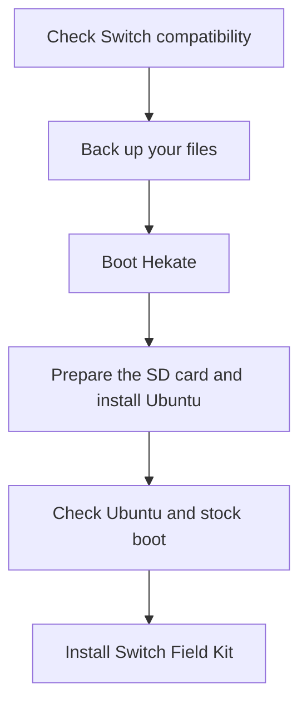

# Install Hekate and Switchroot Ubuntu first

**Start here if your Switch does not already have a working Ubuntu desktop.** This prepares the device for Switch Field Kit. The Field Kit installer does not perform these steps for you.

Already using Ubuntu on your Switch? Keep that working setup and go straight to [installing Field Kit](START_HERE.md#4-download-and-install). Do not repartition just to add this app.

[Compatibility](#1-check-which-switch-you-have) · [Backups](#3-back-up-before-changing-the-card) · [Hekate](#4-put-hekate-on-the-card-and-start-it) · [Ubuntu](#6-install-switchroot-ubuntu) · [Problems](#if-a-step-does-not-work)



Instructions checked against the linked upstream documentation on **8 November 2026**. This is a documented setup path, not a claim that every model or fresh installation has been tested by this project. Use the upstream guide if its requirements have changed.

## 1. Check which Switch you have

| Your starting point | The next step |
| --- | --- |
| Hekate already opens | Keep your existing way of starting it. Continue with backups and the Ubuntu section below. |
| Original Switch, confirmed unpatched | Use the USB recovery-mode route in section 4. |
| Original Switch, possibly patched | Check compatibility before buying tools or erasing a card. A serial-range result can be inconclusive. |
| Patched Switch, V2, Lite or OLED, without a working boot method | The USB route below is not a universal unlock. These normally need specialist hardware work. Resolve that first. |
| Switch 2 | Not supported by Switch Field Kit. |

Find the serial under **System Settings → System → Serial Information**. Use the [Nintendo Homebrew compatibility guide](https://switch.hacks.guide/user_guide/getting_started.html) to identify the relevant route. Keep your full serial private. “Switch 1” alone does not identify the hardware revision.

A modchip is a physical board modification, not an app. This guide covers using an already prepared device, not soldering one. Switchroot confirms support for suitably modified V2, Lite and OLED systems in its [compatibility FAQ](https://wiki.switchroot.org/wiki/faq).

## 2. Gather what you need

- A compatible Switch and its charger.
- A reliable microSD card. A 128 GB card is a practical starting point for this library. Consult the [Switchroot SD card guide](https://wiki.switchroot.org/wiki/sd-card-guide) before buying one.
- A Windows, Mac or Linux computer, a card reader and a USB-C **data** cable. Some cables only charge.
- Internet for the initial downloads and enough computer storage for the backups.
- For the unpatched USB route only: a proper RCM jig. Do not improvise with foil or a paperclip.
- An archive extractor that supports `.7z`. The Ubuntu image is not an ordinary PC installer ISO.

Four terms you will see:

| Term | Plain meaning |
| --- | --- |
| Hekate / Nyx | The boot menu and its touchscreen interface. It starts Ubuntu and provides SD tools. |
| Payload | A small `.bin` file used to start Hekate. |
| Root of the SD card | The top level of the card, before opening any folder. |
| Partition | A separate area of the card, such as boot files or Linux storage. |

## 3. Back up before changing the card

**The partitioning step later in this guide erases the SD card.** A backup left on that same card will be erased too.

Before you begin, copy all visible SD files to a dated folder on your computer. Include `Nintendo`, `bootloader`, existing configuration and any personal files. Open several copied files to check that the copy finished. Keep the original card untouched until you have checked the backup. A separate spare card is the simplest way to retain a known working setup.

If Hekate is not installed yet, make the ordinary file copy now. Return to this checklist after section 4, before partitioning:

- **Internal system backup:** follow the [Hekate backup walkthrough](https://switch.hacks.guide/user_guide/all/making_essential_backups). Under **Tools → Backup eMMC**, save both the boot areas and the main system area. Copy the completed `backup` folder to your computer. Check that Hekate reported completion. This backup is private and belongs only to your console.
- **Existing emuMMC:** this is a separate copy of the Nintendo system used by some custom-firmware setups. A raw-partition emuMMC is not captured by dragging visible files into Finder or Explorer. Follow the emuMMC backup and restoration instructions in the [Switchroot installation guide](https://wiki.switchroot.org/wiki/linux/l4t-ubuntu-jammy-installation-guide). File-based emuMMC is included only if you copied its complete files.
- **Existing Ubuntu:** copy your home folder and library to other storage. Do not expect a fresh Ubuntu install to preserve them.
- **Other installed systems:** use that system's backup procedure before changing its partitions.

If you intend to keep emuMMC or Android and do not know which partitions belong to them, stop before partitioning. Use a spare card or get help identifying the existing layout.

## 4. Put Hekate on the card and start it

### Download the Hekate files

1. Open the [official Hekate release page](https://github.com/CTCaer/hekate/releases/latest).
2. Download the release asset named like `hekate_ctcaer_..._Nyx_....zip`. The GitHub **Source code** ZIP is not the ready-to-use download.
3. Extract it on your computer. Copy its `bootloader` folder to the SD card's top level. Keep the supplied `hekate_ctcaer_....bin` on your computer for the next step.
4. If `bootloader` already exists, merge the release files into it. Preserve your own boot configuration and payloads. Do not delete the whole existing folder. The [Hekate update notes](https://github.com/CTCaer/hekate/releases/latest) explain this distinction.
5. Safely eject the card and insert it into the powered-off Switch.

Expected location: `SD card → bootloader → ...`, not `SD card → downloaded-folder → bootloader`.

### Route A: original unpatched Switch, using USB

RCM is a USB recovery mode with a **black screen**. A black screen alone does not prove the console is broken, or that the USB connection works.

1. Fully power off the Switch. Remove the right Joy-Con and fit the proper jig in the right rail.
2. Hold **Volume Up**, press **Power** once, then release Volume Up after entering RCM. The Nintendo logo should not appear. Remove the jig.
3. Connect the Switch to the computer using the data cable. The injector should detect the recovery device, usually named **APX**.

See the illustrated [RCM procedure](https://switch.hacks.guide/user_guide/rcm/entering_rcm.html) for the jig position. Do not poke the rail contacts with loose metal. Patched consoles can enter RCM but cannot use this USB exploit.

Use [OmniRCM from its developer](https://github.com/DefenderOfHyrule/OmniRCM) to send the Hekate payload:

| Computer | Initial setup |
| --- | --- |
| Windows | Download `OmniRCM-win-x64.exe`. Connect the Switch in RCM, then use the app's **Install Driver** control for the APX device. |
| Mac | Download `OmniRCM-osx.zip`, extract it and open `OmniRCM.app`. Connect the Switch in RCM. |
| Linux | Choose the release matching the computer's architecture. Follow the developer's **Setup udev** instructions and sign out and back in if required. |

In the app, add the Hekate `.bin` you downloaded, select it and choose **Inject Payload**. Consult the [platform-specific walkthrough](https://switch.hacks.guide/user_guide/rcm/sending_payload.html) if the device is not detected. Enter any computer administrator password only into the local system prompt.

**Checkpoint:** the Switch now shows Hekate's touchscreen menu. Downloading the ZIP or seeing APX on the computer is not the completed step.

### Route B: a Switch with an already working modchip

Keep the boot method supplied with your installation. The common arrangement has the Hekate `bootloader` folder and a copy of its payload named `payload.bin` at the card's top level. Use the [modchip payload-placement guide](https://switch.hacks.guide/user_guide/modchip/preparing_hekate) only if it matches your hardware's boot method. Do not replace a working chip configuration based on a guessed filename.

**Checkpoint:** Hekate starts from a full power-off. Return to section 3 and complete the remaining backups before proceeding.

## 5. Plan the space for an offline library

For a **fresh 128 GB card used mainly for Field Kit**, our suggested starting allocation is:

| Area | Suggested allocation | Purpose |
| --- | --- | --- |
| FAT32 | 16 GiB | Hekate files, installation files and room for a modest stock SD folder. |
| Linux | The remaining space, roughly 100 GiB | Ubuntu, guides, Wikipedia and maps. Actual available library space is lower after installing Ubuntu. |
| Android / emuMMC | None for this fresh library-only layout | These are optional separate systems, not Field Kit requirements. |

This is a **project recommendation**, not a migration recipe for an occupied card. If you want stock games on the SD card, allocate enough FAT32 space for them. If you want to retain an existing emuMMC, reserve its required space and follow its restoration procedure. Do not erase it just to copy this example.

Stock Nintendo system storage is internal to the console. Preserving stock boot does not require creating a new emuMMC. Preserve your existing stock boot method and test it afterwards. The Linux library belongs on the Linux partition, where large `.zim` books are not restricted by FAT32's 4 GB per-file limit.

Hekate's partition manager creates a layout rather than shrinking an existing Linux installation in place. See the [Switchroot partition reference](https://wiki.switchroot.org/wiki/documentation/partition-docs). **Do not apply this fresh-card layout to a working setup without backups.**

## 6. Install Switchroot Ubuntu

Keep the [official Noble 24.04 installation guide](https://wiki.switchroot.org/wiki/linux/l4t-ubuntu-noble-installation-guide) open alongside these steps. It includes screenshots and current requirements. At this review, it requires Hekate 6.0.6 or newer. Use the current Hekate release.

1. Download a **Switchroot Noble** `.7z` image from the [official download folder](https://download.switchroot.org/ubuntu-noble/). Choose Kubuntu or Ubuntu Unity. Use `hashes.txt` in that folder to check the download.
2. Confirm your off-card backups. In Hekate, open **Tools → Partition SD Card**. Allocate Linux space and leave at least **8 GiB FAT32** for installation files. Confirm only after checking the proposed layout. **This erases the card.**
3. Mount the SD card on the computer. Restore Hekate's `bootloader` files if absent. Extract the image into the FAT32 top level, without an enclosing folder. Merge folders, preserving Hekate files and the new Ubuntu configuration. Safely eject.
4. Return to **Tools → Partition SD Card → Flash Linux**. Let it finish.
5. Pair Joy-Cons in stock Nintendo OS, attach both, then use **Nyx Options → Dump Joy-Con BT**. Run this on Lite too for calibration data.
6. Open **More Configs**, choose Ubuntu and complete desktop setup. Install normal updates through its software updater.

### Finish the first desktop setup

Create a username and a password you can remember. Ubuntu's `sudo` prompt uses that password. Automatic sign-in does not remove it. Keep it in your password manager, not in a public issue or repository.

Connect Wi-Fi and open a browser. Check touch input, the on-screen keyboard and charging before downloading the library. In Terminal, run:

```bash
df -h "$HOME"
```

The **Avail** column is free space on the filesystem holding your home folder. That is the useful figure for the default library location, not the capacity printed on the card.

Switchroot does not support using Ubuntu's general release-upgrade process to move between major Ubuntu versions. Stay with the update method for your installed image. See the [upgrade FAQ](https://wiki.switchroot.org/wiki/faq).

## 7. Check stock fallback and a complete restart

- Shut Ubuntu down normally. Start Hekate again and confirm Ubuntu still boots.
- Use your existing stock-boot method and confirm the Nintendo home screen appears. On an unpatched console without AutoRCM or a chip, ordinary power-on without the jig or payload uses the normal boot path. Modified boot arrangements can differ, so use your installer's instructions.
- Restore backed-up Nintendo SD files only into the intended FAT32 area. Do not overwrite the new Ubuntu boot files with an old whole-card copy.
- Keep your stock configuration and off-device backups. Never restore another console's internal-system backup.

**Plan for restarting offline:** an unpatched USB setup normally needs the Hekate payload sent again after a full power-off. Save the injector and payload locally and test your restart method without internet. A library that can be read offline is only useful if you can also boot it when needed. This guide does not enable AutoRCM.

## 8. Install Field Kit

Once Ubuntu and stock fallback both work, continue to [Start here: download and install](START_HERE.md#4-download-and-install).

In Ubuntu: download the Field Kit ZIP, extract it, open the extracted folder in Terminal and run:

```bash
bash setup.sh
```

Install the guides, then choose any books and maps you need. Turn Wi-Fi off and check a guide, an enlarged page, a book search and a saved map before relying on the offline library.

## If a step does not work

| What you see | What to check first |
| --- | --- |
| Black screen before Hekate | Check whether the injector detects APX. If it does, confirm compatibility and send the Hekate payload. If it does not, check power, RCM entry and the data cable. Do not format the card as a first response. |
| Hekate says its bootloader files are missing | Check that the release's `bootloader` folder is at the card's top level and matches the payload. |
| Ubuntu is missing under More Configs | Check that the Switchroot archive was extracted at the FAT32 top level, including its boot configuration. |
| Flash Linux cannot find installation files | Check extraction completed and that there is no extra enclosing folder. Compare with the official image instructions. |
| Ubuntu starts, but an app will not install | The Switch uses ARM64. An ordinary Windows installer or Linux x86-64 package is the wrong architecture. See [Switchroot common issues](https://wiki.switchroot.org/wiki/common-issues). |
| Wi-Fi fails in Noble | Check the [Noble guide's known issues](https://wiki.switchroot.org/wiki/linux/l4t-ubuntu-noble-installation-guide), including its WPA3 selection issue. |
| You do not know the Ubuntu password | Automatic login is not proof of a blank password. Use the account you created. Do not edit password files using instructions intended for a different installation. |

For Field Kit problems after Ubuntu is working, use [Troubleshooting](TROUBLESHOOTING.md). For boot or image problems, use the linked Hekate and Switchroot documentation. Record the exact error before changing anything else.
